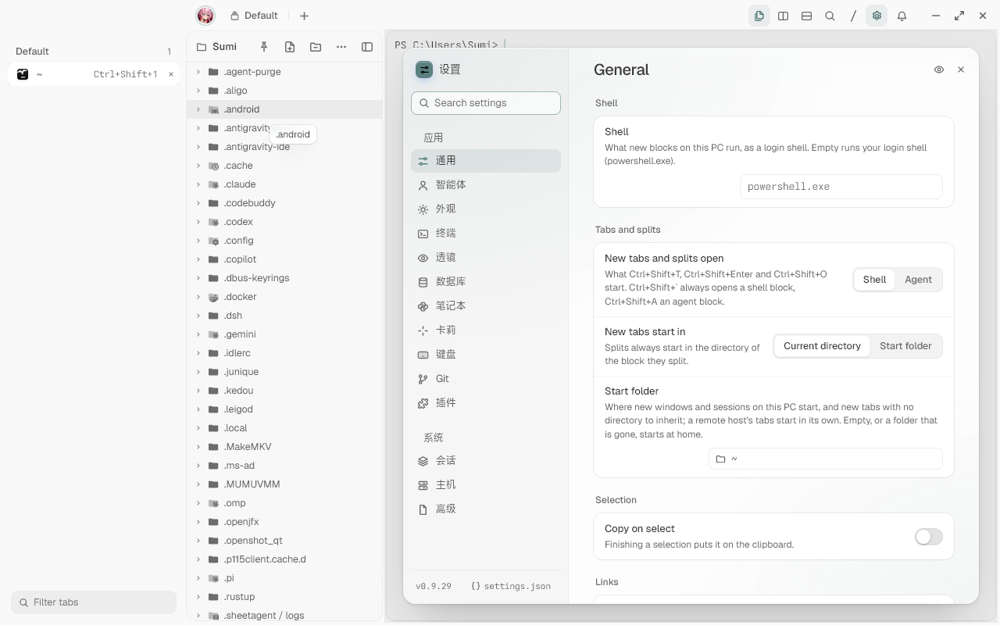
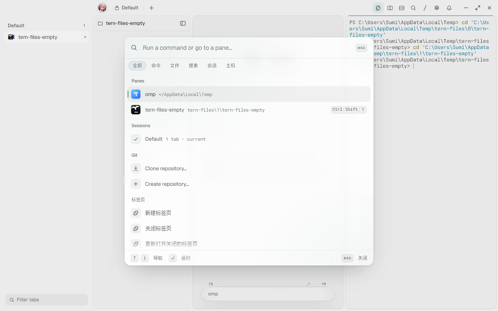

# tern-zh-cn

Tern 终端的简体中文汉化插件（0.4.0，按 Tern 0.9.29 实测 DOM 重写）。

[Tern](https://stencil.so/tern) 是 Stencil 的 Rust 原生终端，官方没有 i18n 框架。本插件用官方插件机制做"半汉化"：

- **中文命令面板**：把 0.9.29 的**全部 240 条内置动作**注册成中文标题的包装命令（`cx.actions:list()` 导出，按 25 个中文分组），命令面板（`Ctrl+Shift+P`）里直接打中文搜索并执行，如"新建标签页""向右拆分""更换主题""检查更新"。英文原行保留。
- **静态文字替换**：命令面板作用域页签、底部按键提示、空结果说明；设置面板的标题、分组、14 个导航项，**以及正文——14 个页面标题、97 个节标题、10 个页面的整页文案（通用/智能体/外观/终端/会话/主机/高级/笔记本/Carly/插件）**（用 `:has()` 按"当前选中的导航项"定位页面）；文件面板空目录文案。





## 安装

```sh
tern plugin install github.com/maicent/tern-zh-cn
```

或在 Tern 的 Preferences › Plugins 里填同样的 GitHub 地址。

## 覆盖范围与边界

完整的英文文案清单、逐项可行性判断与实测 DOM 证据见 [LOCALIZATION.md](LOCALIZATION.md)。要点：

- 标签栏、工具栏、窗口按钮的文字只存在于 `title` 属性（tooltip），CSS 改不到；
- 输入框占位符是原生 attribute，`::placeholder { content }` 引擎不渲染；
- 右键菜单项只有 `class="mi"`，同一个容器服务所有菜单，没有可供区分的动作标识；
- 设置正文的 `.pf-doc` 没有 `data-page`，同一位置在不同页含义不同，按位置翻译会误标；
- toast、错误消息、对话框正文是运行时字符串，插件 API 没有文本拦截钩子。

## 实现方式

- `window.luau`：`tern.command` 注册 240 条中文包装，`run` 里 `cx:action("<原 id>")`，不改行为；失败时弹中文提示。
- `zh-cn.css`：`font-size: 0` 隐藏原文 + `::before/::after { content: "中文" }` 注入翻译；颜色与字重 `inherit`，选中态跟着 Tern 自己的配色走。

## 维护

```sh
tern plugin reload zh-cn
tern ctl css                    # 应含 plugin:local:zh-cn:styles
tern ctl --control … tree       # 带文字的 DOM 树，升级后照它核 class
tern ctl --control … dump SEL   # 盒子 + 计算样式，核字号
tern ctl --control … shot NAME  # 截图 + layout.json
```

Tern 升级后若文字"复活"，先看 `tern ctl tree` 的 class 是否变化，再按 `zh-cn.css` 里的注释逐段恢复。

## License

MIT
