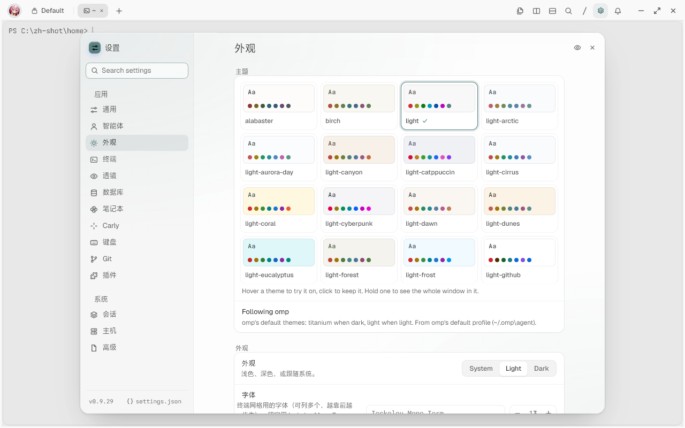
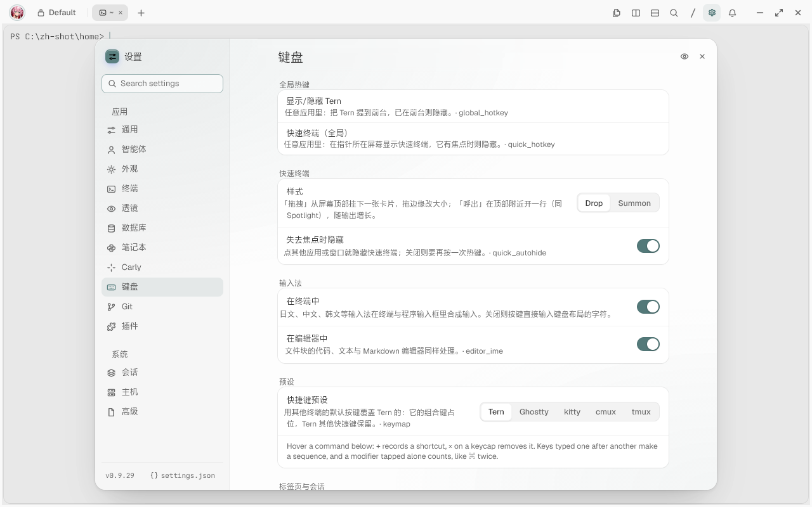
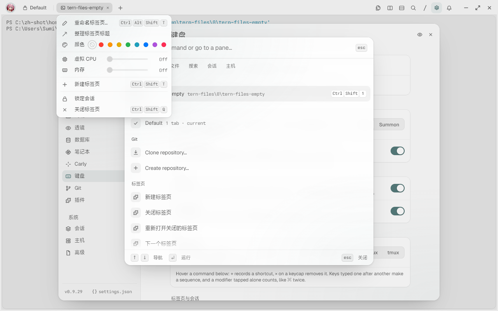

# tern-zh-cn · Tern 简体中文汉化

[Tern](https://stencil.so/tern)（Stencil 的 Rust 原生终端）的简体中文插件。Tern 目前没有 i18n 框架，本插件用官方插件机制做「半汉化」：

- **命令面板全中文**：把 0.9.29 的 **240 条内置动作**注册成中文包装命令（`cx.actions:list()` 导出，25 个中文分组）。`Ctrl+Shift+P` 直接打中文搜索执行，如「新建标签页」「向右拆分」「更换主题」「检查更新」。
- **界面静态文字**：命令面板页签与底部提示、设置面板导航与正文（14 页标题、97 个节标题、12 页整页文案）、文件面板空目录、顶栏标签页右键菜单。

适用版本：**Tern 0.9.29**（Windows x64 / macOS 实测 DOM 一致）。插件版本 **0.7.0**。








---

## 安装

### 方式一：从 GitHub 装（推荐）

```sh
tern plugin install github.com/Ansgwrt/tern-zh-cn
```

也可以在 Tern 里：`Preferences（Ctrl+,）› Plugins › 填 github 地址 › Install`。

装完执行一次让样式生效：

```sh
tern plugin reload zh-cn
```

窗口样式表在窗口启动时载入；若界面没变，**关掉 Tern 重开一次**（会话由守护进程保留，不会丢）。

### 方式二：本地目录装

```sh
git clone https://github.com/Ansgwrt/tern-zh-cn.git
tern plugin link ./tern-zh-cn        # 就地使用，改文件后 reload 即可
# 或
tern plugin install ./tern-zh-cn --force
```

插件实际安装目录（Windows）：`%APPDATA%\Tern\plugins\zh-cn`。

---

## 验证安装

```sh
tern plugin list                     # 应显示  zh-cn 0.7.0 中文汉化 — window ready
tern ctl css                         # 应含 plugin:local:zh-cn:styles 与 zh-cn-menus 两个样式表
tern ctl palette                     # 命令面板，中文行 240 条
```

界面里检查三处：

1. `Ctrl+Shift+P` → 输入「新建」→ 出现中文命令；
2. `Ctrl+,` → 左侧导航是「应用 / 系统」+ 中文项，正文中文；
3. 右键顶栏标签页 → 「重命名标签页…」「关闭标签页」等。

---

## 更新

```sh
tern plugin install github.com/Ansgwrt/tern-zh-cn --force   # 覆盖安装最新版
tern plugin reload zh-cn
```

自己改了文件想立刻看效果：

```sh
tern plugin reload zh-cn      # 重载插件
# 样式改动需要窗口重新载入：关掉 Tern 重开
```

## 卸载

```sh
tern plugin remove zh-cn
```

界面恢复英文；不会改动 Tern 自身文件。

---

## 覆盖范围

| 区域 | 状态 |
|---|---|
| 命令面板：页签、底部提示、空状态、240 条中文命令 | ✅ |
| 设置：标题、分组、14 个导航项 | ✅ |
| 设置正文：14 页标题 + 97 个节标题 | ✅ |
| 设置正文整页：通用、智能体、外观、终端、会话、主机、高级、笔记本、Carly、插件、数据库、Git、键盘 | ✅ |
| 文件面板空目录 | ✅ |
| 顶栏标签页右键菜单：8 项 | ✅ |
| 透镜页正文 | ⏳ 待做 |
| 终端/文件/PiP 右键菜单 | ⛔ 需要上游给菜单项加 `data-action` |
| 标签栏、工具栏按钮的 tooltip | ⛔ 文字只存在于 `title` 属性 |
| 输入框占位符 | ⛔ 引擎不渲染 `::placeholder { content }` |
| toast / 错误 / 对话框 | ⛔ 运行时字符串，无文本钩子 |

逐项依据与实测 DOM 见 [LOCALIZATION.md](LOCALIZATION.md)。

---

## 已知限制

- **Tern 升级会失配**：选择器按 0.9.29 实测 DOM 写成，Tern 改版后部分文字可能「复活」，需要照 `LOCALIZATION.md` 的 DOM 表更新。
- **键盘页较重**：该页有 1.7 万元素，样式计算约 0.26s（不装插件 0.09s），切换整页约 0.8s。为了中文，这是纯 CSS 方案的代价。
- **样式体积上限**：插件 `styles` 合计不能超过 256 KiB，超了整份样式会被 Tern 拒载（报 `styles are larger than 256 KiB`）。当前 `zh-cn.css` 约 236 KiB，再加页面前需要拆文件。
- **部分菜单项保持英文**：复制会话链接、把标签页移到窗口… —— 是否出现会改变按钮序号，硬套会错标。

---

## 实现方式

- `window.luau`：`tern.command` 注册 240 条中文包装命令，`run` 里调用 `cx:action("<原 id>")`，不改行为；失败弹中文提示。
- `zh-cn.css`：`font-size: 0` 隐藏原文 + `::after { content: "中文" }` 注入。
  - 页面级翻译用「变量表」：14 条带 `:has()` 的规则按「被选中的导航项」判定当前页，正文规则用 `var()` 取值 —— 引擎在有 `:has()` 时会丧失规则索引，键盘页会从 0.26s 恶化到 2.3s。
  - 中文比拉丁字在字身框里更靠上，统一 `padding-top: 1px; margin-bottom: -1px` 做 1px 视觉对齐（伪元素上 `position/transform/vertical-align` 被引擎忽略）。
- `zh-cn-menus.css`：标签页右键菜单，按结构特征（4 个按键芯片、色板、滑块、末两项）定位，`flex order` 把中文排到图标之后、芯片之前。

### 生成器（开发用）

```sh
python tools/gen_prefs_css.py     # 设置正文：填 BODY[(组, 序)] 表 → 生成 CSS
python tools/gen_menus_css.py     # 右键菜单规则
python tools/kb_build.py          # 键盘页：从动作表 + 手写表生成行文案
```

填完表跑一次，把生成的 `zh-cn.css` / `zh-cn-menus.css` 覆盖到插件目录，`tern plugin reload zh-cn` 并重开窗口即可。

---

## License

MIT
